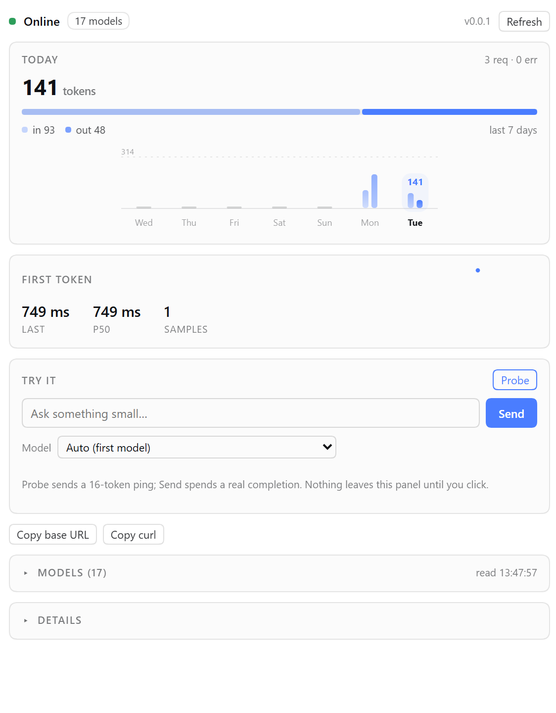

# dsh-dumate-gateway

English | [中文](README.zh.md)

Bring locally running OpenAI-compatible model services into DeepSeek Harness — starting with the
DuMate desktop app — without hand-editing a provider profile for every restart.

Unofficial and not affiliated with Baidu. It only talks to services already running on your own machine.

## Status: discovery, forwarding, the local gateway and a sidebar panel work

What works today:

- the package installs into a DSH profile as a bundle;
- the model selector lists the live DuMate model table with real context windows, read from the
  file DuMate writes on every launch — curated to chat models by default (43 raw rows collapse to
  17 chat models on the author's install), with `models.mode: all` to see everything;
- chat completions stream back with reasoning and text as separate blocks, usage before finish;
- when DuMate is not running, one placeholder model explains how to start it;
- a loopback HTTP gateway serves the same upstream to ordinary clients;
- a right-sidebar panel is a small dashboard: upstream status, today's tokens with an in/out
  proportion bar and a seven-day paired chart, a first-token latency sparkline, a test box with a
  one-click connection probe, quick copy actions, and two closed drawers (models, diagnostics) — all fed over the host's same-origin `/api/dumate-gateway/status`
  route (no CORS or CSP surprises), refreshed every 15 seconds;
- the panel can send **one small test message** — pick which model it uses from a dropdown — and
  keeps a local usage ledger: today's requests, tokens in and out, and errors, in
  `~/.dsh/dumate-gateway/usage.json` for seven days, never sent anywhere. The latency sparkline
  lives in the page's `localStorage`, not in that file;
- a **one-click Probe** answers "is it connected right now?" with a 16-token ping, reporting the
  model it reached and first-token/total latency — or the exact reason it failed, without spending
  a real completion.



The test message and the Probe are the only things in the panel that spend quota, and only when a
person presses **Send** or **Probe**; everything else is local bookkeeping.

The first install needs one restart of DSH. After that, the panel picks up client-side changes on a
page refresh, and host-side changes by toggling the plugin off and on in **Plugins**.

## Account safety

This plugin is built to look exactly like you typing in DuMate, and to add no hidden traffic:

- the gateway binds `127.0.0.1` only and is never exposed to the network;
- the panel refreshes itself every 15 seconds by asking the **host**, which reads DuMate's state
  file and opens one TCP connection — no inference request, no token spend, no upstream polling;
- the only requests that reach the model service are your own chat turns; there is no retry loop,
  no keepalive and no scheduled job (a `429`/quota error is surfaced to you as-is, never retried);
- credentials stay in DuMate: the plugin reads `baseURL` and the model table from `opencode.json`,
  where the key is the literal `nokey`, and it never echoes a key.

Do not point batch jobs or unattended automation at `http://127.0.0.1:7321`: that is what turns
ordinary personal usage into the traffic pattern that gets an account flagged.

## Install from the DSH Discover index

DSH ships no central plugin index: `Plugins → Discover` lists only the index sources a person adds.
This repository publishes one, so the plugin shows up there with its icon, description and version:

```text
https://raw.githubusercontent.com/titor-jz/dsh-dumate-gateway/main/market/index.json
```

1. `Plugins` → **Experimental plugins** → switch on **Custom plugin indexes**.
2. Open the **Discover** tab → **Add index source** → paste the URL above.
3. Select **DuMate gateway** → **Install**. It installs from this repository at a pinned commit.

Without an index you can still install it directly: `Plugins` → **Add plugin** → paste
`git+https://github.com/titor-jz/dsh-dumate-gateway.git`, or point the dialog at a local checkout.

## Install

DeepSeek Harness → **Plugins** → **Add plugin** → pick this directory. Host-only bundle: no build
step, no dependencies, no install scripts. The HTTP gateway starts with the plugin on
`http://127.0.0.1:7321`.

## Use it from other clients

```bash
curl -s http://127.0.0.1:7321/health
curl -s http://127.0.0.1:7321/v1/models

curl -N http://127.0.0.1:7321/v1/chat/completions \
  -H 'content-type: application/json' \
  -d '{"model":"deepseek-v4-flash-0731","messages":[{"role":"user","content":"hi"}],"stream":true}'
```

Anthropic-shaped clients (for example Claude Code pointed at the gateway) can call
`POST /v1/messages`; thinking blocks are not forwarded, text and stop reasons are.

## Optional: a provider row on Settings → Models

That page lists providers that need an API key or a base URL, and it only renders rows backed by a
settings namespace (`llm-deepseek` or `llm-pi-ai`); a plain adapter route such as this plugin's
`gateway` provider is filtered out, and a third-party namespace would render read-only anyway. So
the supported way to get an editable row there is the page's own custom-provider flow:

1. Settings → Models → **Add model provider** → **Custom model API**.
2. API address `http://127.0.0.1:7321/v1`, protocol `openai-completions`.
3. API key: any placeholder such as `nokey` — the loopback gateway does not check it unless
   `http.token` is configured.
4. Press the discovery button; the model list comes from `GET /v1/models`.

Trade-off: DSH then talks to the gateway through its own pi-ai adapter, not through this plugin's
adapter, so the model selector shows both groups — the "DuMate gateway" group (curated,
no key needed) and the custom provider you added. Use the plugin group for everyday work; the
custom row is there when you want the gateway managed from that page.

Set `http.token` in the plugin config to require `Authorization: Bearer <token>` (or `x-api-key`)
on every route except CORS preflight. The gateway only listens on `127.0.0.1`, and only echoes CORS
for loopback origins, so the DSH web UI can read it without opening the port to the network.

## Configuration

```yaml
http:
  enabled: true          # the loopback gateway on 127.0.0.1:7321
  port: 7321
  token: null            # non-null → require Bearer / x-api-key
requireReachable: true   # false → forward even when the TCP probe fails
models:
  mode: curated          # curated (chat models only) | all (raw table, DuMate internals included)
  exclude: []            # extra keys to hide, case-insensitive substring match
```

DuMate mixes its public chat models with internal plumbing (routing helpers, validators, embeddings,
an OCR endpoint, six auto-router levels). `curated` hides those; hiding a model never disables it —
an id you type or configure still forwards.

## Why a bundle

The plugin registers a provider route (`gateway`) on the host's LLM service. The route advertises
its catalog, resolves per-model capacity, and streams chunks in the harness `StreamChunk` protocol,
so nothing outside this package needs to know how a given local service spells its wire format.

## Known limits

- No Responses API, no Gemini `/v1beta`.
- DuMate rate-limits a user's rapid requests; a burst can surface `429 RATE_LIMIT` from the gateway.
- The DuMate port changes on every launch; the plugin reads it from the live config file, so nothing
  needs configuring — but a stale config left by a crashed run is ignored as soon as a newer one exists.

## License

MIT
