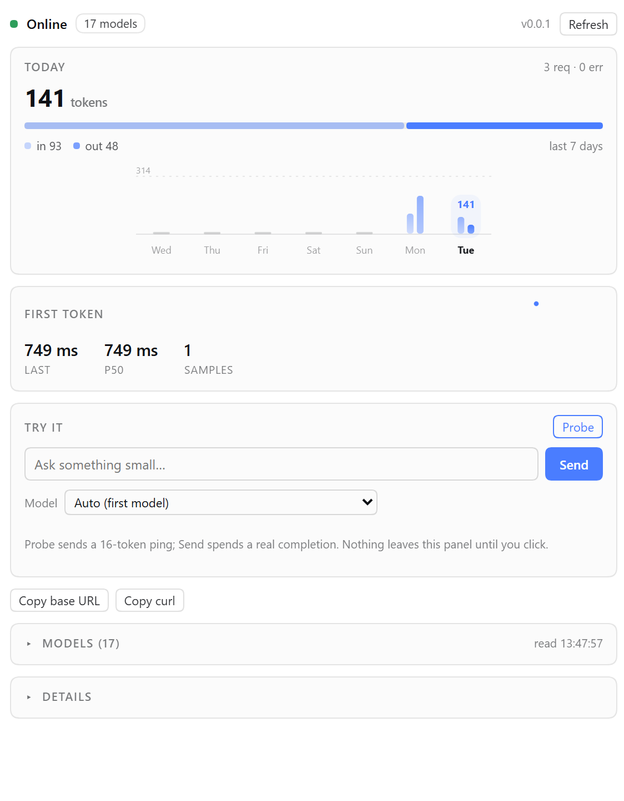

# dsh-dumate-gateway

[English](README.md) | 中文

[](https://www.npmjs.com/package/dsh-dumate-gateway) [](LICENSE)

把**本机正在运行的 OpenAI 兼容模型服务**接进 DeepSeek Harness，第一个支持的是 **DuMate 桌面端**。
不用手动改 provider 配置，DuMate 每次启动换端口也不用管。

> 非官方项目，与百度无关；只连你自己机器上的服务。

## 现在能做什么

- 作为 bundle 装进 DSH 的 profile；
- 模型选择器里直接出现 DuMate 的**实时模型表**，带真实上下文窗口，默认只留对话模型（作者这台机器 43 条原始记录筛成 17 条），想看全部就把 `models.mode` 设成 `all`；
- 对话真流式：推理块和正文字块分开到达，`usage` 在结束块之前给出；
- 模型选择器里有**思考强度**开关（Off / On）——DuMate 只提供这一个思考开关，就是请求体里的 `thinking: {type: 'disabled' | 'enabled'}`；`reasoning_effort`、`enable_thinking` 和所有 `budget_tokens` 写法都实测过，推理长度完全不变，所以不做假的档位阶梯。`kimi-k3` 直接拒绝 `disabled`，因此只给一档；`glm-53`、`glm-53-flash`、`kimi-k31` 被要求停时仍会吐少量推理，各自的选项文案里写明了（见 `docs/DETAIL.md`）；
- 函数调用（tool calls）可透传：`tools` 原样发给上游，返回的 `tool_calls` 会被折回「一个工具一个调用」——DuMate 会把一次调用拆成多个 SSE 分片且 `index` 会漂移，插件负责合并（见 `docs/DETAIL.md`）；
- 图片输入对支持视觉的模型真的可用：附件从 DSH 的 attachment 服务取出，按 `image_url` 发给上游，模型能看到图——否则宿主只给适配器一个不透明 id，图片过去只会变成 `[image attachment]` 文本；
- DuMate 没启动时，只给一个 `Hello` 占位模型，提示你去启动它；
- 另起一个只绑 `127.0.0.1` 的 HTTP 网关，普通客户端也能用（OpenAI 形状，外加最小 Anthropic 形状）；
- 右侧栏面板是一个小仪表盘：上游状态、今日 token（cached/in/out 占比条 + 7 日成对柱状图）、首字延迟走势、试聊框、一键探针、复制按钮，外加两个默认折叠的抽屉（模型列表、诊断信息）；数据走宿主**同源** `/api/dumate-gateway/status`，15 秒刷新一次，不碰跨域；
- 面板可以发**一条很小的测试消息**（下拉选模型），并记本地用量：今天的请求数、in/out token、错误数，写在 `~/.dsh/dumate-gateway/usage.json`，保留 7 天，不外发；缓存命中单独计一档并计入合计，所以面板的 `in` 数字和宿主「设置 → 使用统计」页（把缓存读并入 prompt）口径一致；
- **一键 Probe**：16 token 的 ping，直接回答「现在通不通」，报告命中的模型和首字/总耗时，失败时给出确切原因，不浪费一次正式生成；
- **headless 模式**：只启动网关需要的两个 DuMate 二进制，约 59 MB 而不是一个多 G；默认不会自己启动，必须由你按 **Start headless** 才开始。停止时先确认该 pid 仍运行 DuMate 的镜像才结束进程；如果桌面端和这两个后台进程同时在线，面板会给出警告（两者共用一个数据目录）。



面板里只有 **Send** 和 **Probe** 会消耗额度，而且只有你按下去时才会；其他都是本地记账。

首次安装需要重启一次 DSH；之后客户端改动刷新页面即可，宿主改动在 **Plugins** 里把插件关掉再打开。

## 账号安全

这个插件的设计目标是：看起来就像你自己在用 DuMate，不额外制造任何流量。

- 网关只绑 `127.0.0.1`，不暴露到网络；
- 面板 15 秒刷新是问**宿主**，宿主只读 DuMate 写的状态文件 + 开一条 TCP 连接，**不产生推理请求、不耗额度、不轮询上游**；
- 真正到达模型服务的只有你自己的对话轮次；没有重试循环、没有 keepalive、没有定时任务（`429`/额度错误如实上报，绝不自动重试）；
- 凭据留在 DuMate：插件只读 `opencode.json` 里的 `baseURL` 和模型表，里面的 key 字面量就是 `nokey`，插件从不回显任何凭据。

**不要把批量任务或无人值守的自动化指向 `http://127.0.0.1:7321`** —— 那才会把「个人正常使用」变成「会让账号被风控的流量特征」。

## 安装

### 方式一：从 DSH 插件市场（Discover）装

DSH 没有中央插件市场，Discover 只读用户自己添加的索引。本仓库发布了一个索引：

```text
https://raw.githubusercontent.com/titor-jz/dsh-dumate-gateway/main/market/index.json
```

1. `Plugins` → Experimental plugins → 打开 **Custom plugin indexes**；
2. 进 **Discover** → **Add index source** → 粘贴上面的 URL；
3. 选中 **DuMate gateway** → **Install**（从 npm 装 `dsh-dumate-gateway`）。

### 方式二：直接装

`Plugins` → **Add plugin** → 粘贴包名 `dsh-dumate-gateway`（走 npm），
或 `git+https://github.com/titor-jz/dsh-dumate-gateway.git`，或直接指向本地 checkout 目录。
纯宿主 bundle：无构建、无依赖、无安装脚本。

HTTP 网关随插件启动，地址 `http://127.0.0.1:7321`。

## 给其他客户端用

```bash
curl -s http://127.0.0.1:7321/health
curl -s http://127.0.0.1:7321/v1/models

curl -N http://127.0.0.1:7321/v1/chat/completions \
  -H 'content-type: application/json' \
  -d '{"model":"deepseek-v4-flash-0731","messages":[{"role":"user","content":"hi"}],"stream":true}'
```

Anthropic 形状的客户端（比如把 Claude Code 指过来）可以调 `POST /v1/messages`：转发正文和停止原因；`thinking: {type: 'disabled'}` 能关掉上游思考（但思考文本本身不会作为 thinking 块回传）。OpenAI 形状的调用方用 `reasoning_effort: "none"` 得到同一个开关。

## 可选：在「设置 → 模型」页加一行

那个页面列的是「需要 key 或 baseURL 的提供商」，而且只渲染有设置命名空间（`llm-deepseek` / `llm-pi-ai`）的行——本插件注册的 `gateway` 路由会被过滤掉，第三方命名空间的行也只能只读。所以官方支持的做法是用页面自己的自定义提供商流程：

1. 设置 → 模型 → **添加模型提供商** → **自定义模型 API**；
2. 地址 `http://127.0.0.1:7321/v1`，协议 `openai-completions`；
3. 密钥随便填一个占位（比如 `nokey`）——回环网关默认不校验，除非你配了 `http.token`；
4. 点探测模型，列表来自 `GET /v1/models`。

代价：DSH 会用自己的 pi-ai 适配器访问网关，而不是本插件的适配器，选择器里会出现两个分组。日常用插件那组，这一行只是给「想在那个页面里管理」的人。

## 不开 DuMate 窗口也能用（headless）

DuMate 桌面端是套在两个真正干活的二进制外面的 Electron 壳。本网关只需要那两个，所以可以自己把它们拉起来——
**2 个进程、约 59 MB，而不是 14 个进程、1 GB 左右**，窗口全程不打开。流式表现完全一样。

```yaml
headless:
  enabled: true         # 面板出现「Start headless」按钮，并在加载时自动启动
  autoStart: false      # true → 插件加载时自动起；false → 只有点按钮才起
  baseProxyPort: 53231  # 随便两个空闲回环端口
  mainServerPort: 53232
  stopOnUnload: false   # true → 卸载插件时一并停掉后端
```

它做什么、以及刻意不做什么：

- 复用你已经登录的账号：只读 `auth.json`，**不会要求输入凭据**；从没登录过 DuMate 的机器用不了；
- 从已安装的 DuMate 里起 `dumate-base-proxy.exe` 与 `dumate-main-server.exe`，工作目录设成后端期望的位置；不下载、不修改任何文件；
- 给它注入和 Electron 外壳一样的代理环境变量：`HTTP(S)_PROXY` 指向 base-proxy，密码用本次启动的 nonce。这不是可选项——后端是**经**这个代理去访问百度网关的，域名也由代理解析；不给它，后端就会退回本机 DNS，DNS 一抖就会变成某些轮次报 `failed to forward request to upstream`，而其他一切看起来都正常。0.0.5 之前这里确实有这个 bug；
- 桌面端开着时它什么都不做：桌面端优先，headless 用自己独立的端口；
- 启动失败不会按每条消息重试（最多每分钟一次），所以聊天重试不会变成进程风暴。

面板上的卡片可以直接 Start / Stop；插件加载时、第一次聊天时都不会自己拉起进程，除非把 `autoStart` 显式设成 `true`。两个日志在
`~/.dsh/dumate-gateway/logs`，启动失败的原因会原样显示在面板里。

## 配置

```yaml
http:
  enabled: true          # 回环网关 127.0.0.1:7321
  port: 7321
  token: null            # 非 null → 要求 Bearer / x-api-key
requireReachable: true   # false → TCP 探测失败也转发
models:
  mode: curated          # curated（只留对话模型）| all（原始表，含 DuMate 内部件）
  exclude: []            # 额外隐藏，按 key 大小写不敏感子串匹配
headless:
  enabled: false         # true → 面板可启动 DuMate 的两个后台二进制
  autoStart: false
  baseProxyPort: 53231
  mainServerPort: 53232
  stopOnUnload: false
```

DuMate 把公开对话模型和内部管线混在一张表里（路由助手、校验器、embedding、OCR、六档自动路由）。`curated` 会把它们藏起来；**隐藏不等于禁用** —— 你手写的 id 照样转发。

## 为什么做成 bundle

插件在宿主的 LLM 服务上注册一个 provider 路由（`gateway`）。路由自己声明模型目录、解析每个模型的容量、按 harness 的 `StreamChunk` 协议吐流，所以包外面不需要知道某个本地服务用什么线格式。

## 已知限制

- 不支持 Responses API，也不支持 Gemini `/v1beta`；
- DuMate 对短时间内的连续请求有限流，密集调用会如实返回 `429 RATE_LIMIT`；
- DuMate 的端口每次启动都会变；插件从实时配置文件里读，不需要你配置——但如果上一次崩溃留下的旧配置没被更新的配置盖掉，就会被忽略。

## 许可

MIT
